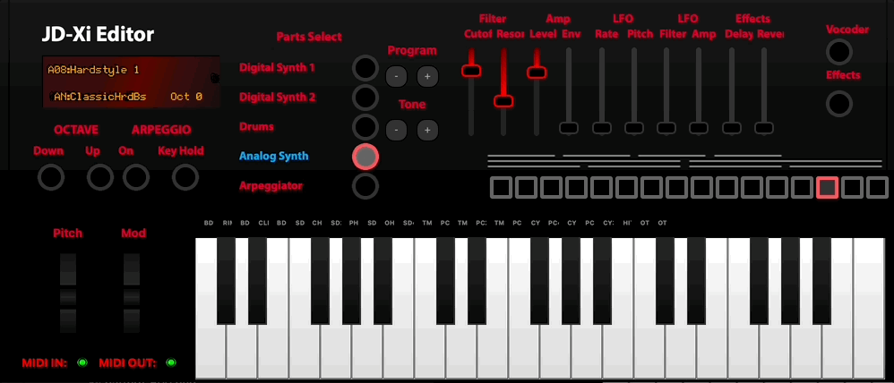
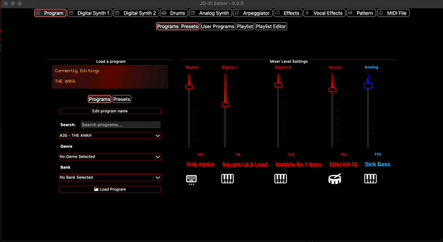
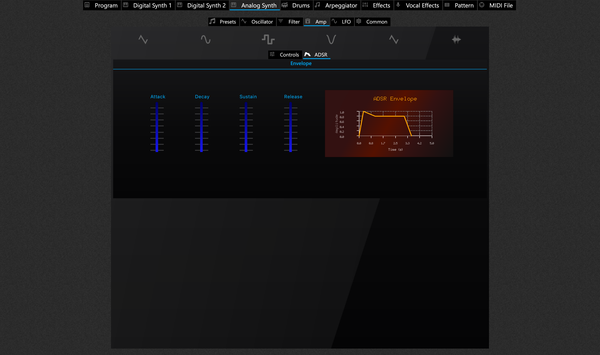
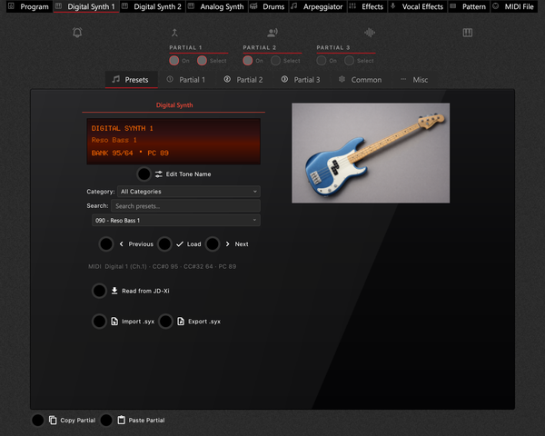
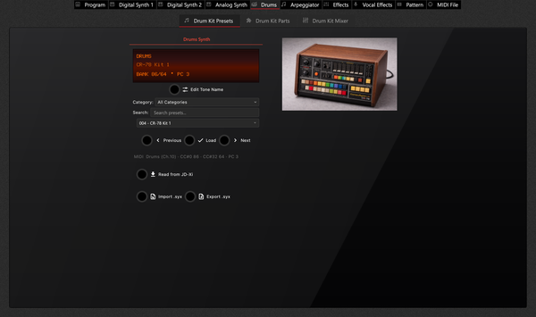
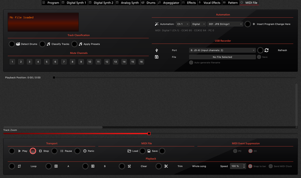
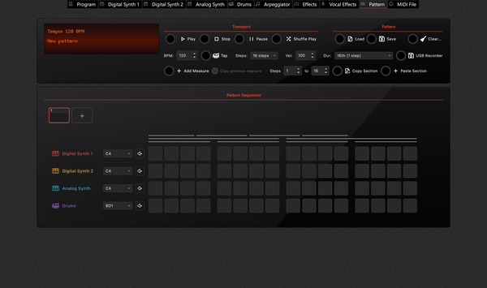
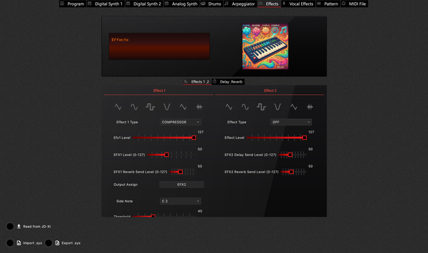
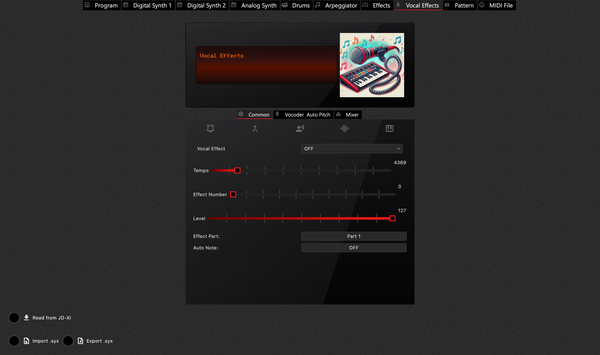
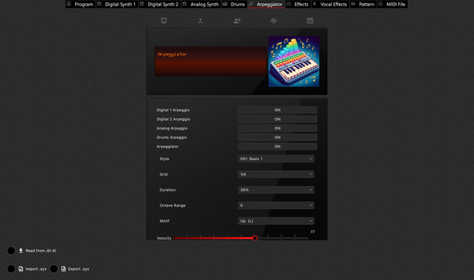

# JDXi-Editor


**JDXi-Editor**: The missing MIDI editor for the **Roland JD-Xi synthesizer**

## Unleash the hidden power of your Roland JD-Xi. 
- Stop fighting menus and start creating. 
- JDXi-Editor puts every sound, control, and performance tool right at your fingertips—fast, visual, and effortless. 
- Shape your tones, browse and save presets, build playlists, and take full command of your synth without breaking your creative flow. 
- Wherever you create—from your home studio to late-night sessions—this is the editor your JD-Xi has always deserved.
- Designed to implement as many features as possible from Roland’s MIDI implementation—without the need to dive through hardware menus. 🎛️

---

## 🎛️ Features of JDXI-Editor for Roland JD-Xi Synthesizer
- **On-Screen Keyboard**: Easily play and test sounds from your JD-Xi.
- **Preset Selection with Search**: Quickly find and load presets.
- **Playlist Cheat Preset**: When playing a playlist entry, this option sends the selected Digital Synth tone's bank select and Program Change to the Analog Synth MIDI channel (channel 3), about two seconds after the entry's normal program change. It selects a tone on that channel; it does not copy patch data into the Analog Synth.
- **Octave Shifting**: Adjust octave ranges for precise sound control.
- **Digital & Analog Synth Editors**: Edit JD-Xi's digital and analog synths directly.
- **Drum Part Editor**: Customize drum sounds and patterns 🥁.
- **Effects Editor**: Edit reverb, delay, compressor, phaser, and arpeggiator settings.
- **Vocal Effects Editor**: Vocoder and Auto-Pitch with polymorphic UI.
- **Pattern Editor**: 4×16 step sequencer with MIDI load/save, part muting, and USB recording.
- **MIDI File Player**: Load MIDI files, classify tracks, assign channels, play with JD-Xi or FluidSynth.
- **SoundFont Support**: Use .sf2/.sf3 for playback without hardware. The Audio output menu chooses the device FluidSynth plays through.
- **Audio Monitor**: Oscilloscope, stereo meters, and a spectrum from an audio **input**. It does not hear the SoundFont.
- **Rack skins**: A JDXiSkin menu of instrument faces, plus TOML skins you keep in `~/.jdxi_editor/skins/`.
- **MIDI Debugger**: Monitor and debug MIDI messages efficiently.

---

Designed for musicians, sound designers, and MIDI enthusiasts looking to unlock the full potential of the Roland JD-Xi synthesizer!

### 🖥️ 'Keyboard Window' Screenshot

<a href="https://github.com/markxbrooks/JDXI-Editor/blob/main/resources/main_window_0.6.gif" rel="Current view of the Roland JD-Xi Editor App">
  
</a>

---
## 🎥 Watch JDXI-Editor in Action

Check out some great performances and demos of the Roland JD-Xi:

- 🎹 [Pink Floyd – *Sheep* 🐑 on the Roland JD-Xi](https://www.youtube.com/watch?v=vh-i8eb2SYQ)  
- 🎹 [Avicii – *Wake Me Up* on the Roland JD-Xi](https://www.youtube.com/watch?v=VyQxaOc6G2Y)  
- 🎹 [Vangelis – *Blade Runner End Titles* | Synth Cover on the Roland JD-Xi](https://www.youtube.com/watch?v=mGgGibBKm9E)  
- 🎹 [Underworld – *Born Slippy* on the Roland JD-Xi](https://www.youtube.com/watch?v=xHLttYaMxCw&list=PLVZK_NOytILiQuNulDn-tOdAUQWdNAS-y&index=18)  
- 🎹 [*Knight Rider Theme* on the Roland JD-Xi](https://www.youtube.com/watch?v=4XpuQm7_Ohs&list=PLVZK_NOytILiQuNulDn-tOdAUQWdNAS-y&index=20)  
- 🎹 [Twin Peaks – *Laura Palmer's Theme* on the Roland JD-Xi](https://www.youtube.com/watch?v=zSkKNoy8O9Y&list=PLVZK_NOytILiQuNulDn-tOdAUQWdNAS-y&index=29)  
- 🎹 [The Cure – *A Forest* on the Roland JD-Xi](https://www.youtube.com/watch?v=wejcaIawCMs&list=PLVZK_NOytILiQuNulDn-tOdAUQWdNAS-y&index=25)  
- 🎹 [Michael Jackson – *Thriller* on the Roland JD-Xi](https://www.youtube.com/watch?v=flFQlFggTug&list=PLVZK_NOytILiQuNulDn-tOdAUQWdNAS-y&index=19)  

---

### 🎬 Featured Demo  

Phil Collins – *In The Air Tonight* performed on the Roland JD-Xi  

[](https://www.youtube.com/watch?v=oquaCQE1EFs)

## 🚀 Getting Started


### Desktop builds

The app version is **1.0.0** (`jdxi_editor/project.py`), and the [1.0.0 release](https://github.com/markxbrooks/JDXI-Editor/releases/tag/v1.0.0) carries a build for each desktop:

| Platform | Download |
| --- | --- |
| macOS | `JD-Xi_Editor_1.0.0_MacOS_Universal.dmg` |
| Windows | `jdxi_editor-1.0.0_setup_win_x86-64.exe` |
| Debian, Ubuntu | `jdxi-editor_1.0.0_amd64.deb` |

Each is built on its own platform from the tag. The `.deb` is amd64; there is no AppImage, and no build for Linux on ARM. Install from PyPI with the steps below instead if you prefer, or check out the tag and follow [Building](doc/building.md). What the release contains, and what is known to be wrong with it, is in [CHANGELOG.md](CHANGELOG.md) and [Known issues](doc/known-issues.md).

Earlier tags have nothing to download: 1.0.0rc1 and 1.0.0rc2 were tagged without files, and the v0.9.6 assets are an older editor, with neither the rack skins nor the Audio output menu.

1.0.0 is the first stable release. It adds no features over 0.9.9, and fixes one piece of chrome since 1.0.0rc2. The app stays Beta. The hardware suite has been run on a connected JD-Xi; the result is in [Known issues](doc/known-issues.md).

### A JD-Xi, and playback without one

MIDI Configuration chooses the JD-Xi's input and output. `python -m pytest -m hardware` passed on a connected JD-Xi: identity, temporary program, digital, analog, drum, effect, and arpeggio reads, one restored temporary digital byte, a one-bar playback, and a recording capture. SoundFont playback and the Audio Monitor do not need a JD-Xi. The monitor listens to an audio input and does not hear the SoundFont.

### Python 🐍
JD-Xi Editor is on PyPI (Python 3.10 to 3.12). Install it in a virtual environment and start it with `jdxi-editor`:

```bash
$ python -m venv jdxi-env
$ source jdxi-env/bin/activate        # Windows: jdxi-env\Scripts\activate
$ python -m pip install JDXI-Editor
$ jdxi-editor
```

PySide6 is pinned to `>=6.8.1.1,<6.10`. 6.12 crashes the main window when a queued slot receives outgoing MIDI. 6.10 and 6.11 have not been tried.

Recording and SoundFont playback use sounddevice, whose wheels include PortAudio. SoundFont playback also needs FluidSynth (`brew install fluid-synth`, `sudo apt install fluidsynth`, or the Windows DLLs shipped with a frozen build). The candidate `.deb` is versioned `1.0.0rc1`, which dpkg orders after `1.0.0`, so apt will not upgrade that package to the finished release. Reinstall instead.

To run from a checkout instead (for development):

```bash
$ git clone https://github.com/markxbrooks/JDXI-Editor.git
$ cd JDXI-Editor
$ python -m venv venv
$ source venv/bin/activate
$ python -m pip install -e ".[dev]"
$ python -m jdxi_editor.main
```

# 📖 Documentation

## Features and Usage

See **[Features and Usage](doc/features-and-usage.md)** for:

- **Patch loading and saving** — `.jsz`, `.msz`, `.json`, and `.syx`. Loading a patch sends it to the instrument.
- **SoundFont usage** — FluidSynth playback, and the preset list read from an `.sf2` or `.sf3`.

Caveats for this candidate are in **[Known issues](doc/known-issues.md)**.

---

## ℹ Available Documentation:
### 📃 HTML Documentation:

https://markxbrooks.github.io/JDXI-Editor/

### 🎹 UI Previews


**Program Editor**  
<a href="https://github.com/markxbrooks/JDXI-Editor/blob/main/resources/program_editor.gif">
  
</a>

&nbsp;

**Analog & Digital Synths**  
<a href="https://github.com/markxbrooks/JDXI-Editor/blob/main/resources/analog_synth.png">
  
</a>

&nbsp;

<a href="https://github.com/markxbrooks/JDXI-Editor/blob/main/resources/digital_synth.png">
  
</a>

&nbsp;

**Drum Editor**  
<a href="https://github.com/markxbrooks/JDXI-Editor/blob/main/resources/drum_editor.png">
  
</a>

&nbsp;

**MIDI File Player**  
<a href="https://github.com/markxbrooks/JDXI-Editor/blob/main/resources/midi_player.png">
  
</a>

&nbsp;

**Pattern Sequencer**  
<a href="https://github.com/markxbrooks/JDXI-Editor/blob/main/resources/pattern.png">
  
</a>

&nbsp;

**Effects**  
<a href="https://github.com/markxbrooks/JDXI-Editor/blob/main/resources/effects.png">
  
</a>

&nbsp;

**Vocal Effects**  
<a href="https://github.com/markxbrooks/JDXI-Editor/blob/main/resources/vocal_effects.png">
  
</a>

&nbsp;

**Arpeggiator**  
<a href="https://github.com/markxbrooks/JDXI-Editor/blob/main/resources/arpeggiator.png">
  
</a>

---

## 🎛️ Features

- On-screen Keyboard
- Preset selection with search
- Octave shifting
- JD-Xi-style LCD Display
- ADSR displays
- Pitch ENV displays
- Digital Synth Parts 1 & 2 (including 3 partials per part)
- Analog Synth Editor
- Drum Part Editor 🥁
- Effects: Reverb, Delay, Compressor, Phaser, Vocoder
- Vocal Effects Editor (Vocoder, Auto-Pitch)
- Arpeggiator Editor
- Pattern Editor (4×16 step sequencer, MIDI load/save)
- MIDI File Player (track classification, channel assignment)
- SoundFont (.sf2/.sf3) playback without hardware

---

## ❓ Frequently Asked Questions
### What is JDXI-Editor?
JDXI-Editor is a Python-based MIDI editor for the Roland JD-Xi synthesizer, built with the Qt Framework and RtMidi.
### Does JDXI-Editor work on MacOS, Linux and Windows?
Yes, JDXI-Editor supports MacOS, Linux, and Windows!
### What features does JDXI-Editor offer?
JDXI-Editor provides preset selection, synth editing, drum part customization, effects editing, and more.

---

- Learn more about the [Roland JD-Xi Synthesizer](https://www.roland.com/global/products/jd-xi/).
- Explore the [Qt Framework](https://www.qt.io/) for building cross-platform apps.
- Discover [RtMidi](https://www.music.mcgill.ca/~gary/rtmidi/), a real-time MIDI library.

---

### 💡 Contribute and Share Feedback
JDXI-Editor is a growing project! 
- ⭐ Star this repository to support its development.
- 🛠️ Contribute features or report issues via [GitHub Issues](https://github.com/markxbrooks/JDXI-Editor/issues). See [CONTRIBUTING.md](CONTRIBUTING.md) for tests and builds.

---

## Building

Packages are built from a checkout. Notes, the Linux command, a sample build log, and the research snippets live in [doc/building.md](doc/building.md).

Mac disk image:

```bash
python3 -m building.buildsys --dmg
```

Mac application:

```bash
python3 -m building.buildsys --app
```

Mac installer package:

```bash
python3 -m building.buildsys --pkg
```

Windows:

```powershell
.\building\scripts\build.ps1
```

## 🙏 Credits

- [Qt](https://www.qt.io/)
- [RtMidi](https://www.music.mcgill.ca/~gary/rtmidi/)
- [Cursor.ai](https://cursor.so)
- [qtawesome](https://github.com/spyder-ide/qtawesome)
- Inspiration from many great JD-Xi editor projects that paved the way
- **Roland**, for creating such a powerful little synth!

---

> Made with 🎹 and ☕ by @markxbrooks

